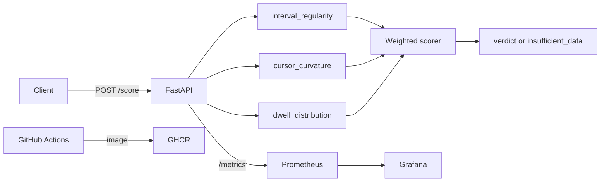

# Input Automation Detector

[](https://github.com/razvanchirila/input-automation-detector/actions/workflows/ci.yml)
[](LICENSE)

An HTTP service that scores a burst of mouse and keyboard telemetry for how likely it is
to come from automation, using three independent statistical detectors and an
explainable weighted score.

## Results

Held-out half of a 12,000-session synthetic corpus in which 45% of the bots are humanized
("evasive"); only the decision threshold is fitted, on the other half.

- ROC AUC 0.966 for all bots vs humans, 0.923 for evasive bots vs humans.
- Max-F1 threshold (0.1923): precision 0.895, recall 0.894, false-positive rate 10.5%; evasive-bot recall 0.76.
- Conservative threshold (0.2907): precision 0.989, recall 0.723, false-positive rate 0.84%; evasive-bot recall 0.37.
- The data is synthetic, so these figures measure separation of this generator's populations, not real-world accuracy.

## Architecture



## Quick start

```bash
docker compose up --build -d
curl -s "http://127.0.0.1:8000/demo?kind=bot_evasive&seed=1"
```

Interactive API docs are at http://127.0.0.1:8000/docs. To score your own payload, fetch
an example with `GET /synth` and post it back to `POST /score`:

```bash
curl -s "http://127.0.0.1:8000/synth?kind=human&seed=1" > s.json
curl -s -X POST http://127.0.0.1:8000/score -H "content-type: application/json" -d @s.json
```

## API

| Method | Path | Purpose |
|---|---|---|
| `POST` | `/score` | Score a session. Returns the combined score, every detector's score, and a verdict at the configured threshold. |
| `GET` | `/synth` | Generate an example session (`kind` = `human` / `bot_naive` / `bot_evasive`, optional `seed`). |
| `GET` | `/demo` | Generate and immediately score one session. |
| `GET` | `/health` | Status plus the active detectors, weights and threshold. |

A detector with too little data to decide abstains: its entry in `detector_scores` is
`null` and it is left out of the weighted mean, whose remaining weights are renormalized.
If every detector abstains, as for a two-event session, the response carries
`"insufficient_data": true` with `score` and `verdict` both `null`, so a short session is
never flagged.

```json
{"session_id": "tiny", "score": null, "detector_scores": {"interval_regularity": null,
 "cursor_curvature": null, "dwell_distribution": null}, "threshold": 0.1923,
 "verdict": null, "insufficient_data": true, "n_events": 2}
```

## Operations

**Probes and metrics**

| Path | Purpose |
|---|---|
| `GET /livez` | Liveness. Always `200` while the process serves HTTP; used by the Docker `HEALTHCHECK`. |
| `GET /readyz` | Readiness. `503 {"status":"starting"}` until a warm-up scoring pass has run at startup, then `200`. |
| `GET /metrics` | Prometheus exposition. |

Custom series: `iad_http_requests_total{method,route,status}`,
`iad_http_request_duration_seconds{method,route}` (histogram), `iad_score` (histogram of
combined scores) and `iad_verdicts_total{verdict="bot"|"human"|"insufficient"}`. Routes
are labelled by template, and unknown paths collapse to `unmatched`, so label cardinality
stays bounded.

**Configuration** (environment variables)

| Variable | Default | Effect |
|---|---|---|
| `IAD_MAX_EVENTS` | `10000` | Maximum events per session. Larger bodies get `422` at validation, before any detector runs. |
| `IAD_LOG_LEVEL` | `INFO` | Root log level. |
| `WEB_CONCURRENCY` | `1` | Uvicorn worker processes. Prefer more replicas over more workers. |
| `PROMETHEUS_MULTIPROC_DIR` | unset | Required when `WEB_CONCURRENCY > 1`: an empty writable directory (e.g. `/tmp/metrics`) so `/metrics` aggregates all workers. |
| `FORWARDED_ALLOW_IPS` | `127.0.0.1` | Proxies whose `X-Forwarded-*` headers uvicorn trusts (`--proxy-headers` is on). Set it to your load balancer's address. |

**Logging.** One JSON object per line on stdout. Every request produces one `iad.access`
line, and every line written during a request carries its `request_id`. The ID is taken
from an incoming `X-Request-ID` header when it is 1-128 characters of `[A-Za-z0-9._:-]`,
generated otherwise, and echoed back in the response header.

```json
{"ts": "2026-11-18T19:09:08.952Z", "level": "info", "logger": "iad.access", "msg": "request", "request_id": "demo-1", "method": "GET", "path": "/demo", "route": "/demo", "status": 200, "duration_ms": 5.17}
```

**Container.** Multi-stage build on a digest-pinned `python:3.11-slim`; the runtime stage
installs prebuilt wheels from the runtime lock only (no test or evaluation dependencies),
runs as UID 10001, and stops gracefully on `SIGTERM` within 20 s. Compose runs it with a
read-only root filesystem, a tmpfs `/tmp`, all capabilities dropped,
`no-new-privileges`, CPU/memory/pid limits, and ports bound to localhost.

**Monitoring profile.**

```bash
docker compose --profile monitoring up --build -d
```

Adds Prometheus on http://127.0.0.1:9090 (scraping `api:8000/metrics` every 5 s) and
Grafana on http://127.0.0.1:3000 with a provisioned datasource and an *Input Automation
Detector* dashboard: request rate, p95 latency, verdict counts and the score histogram.
Anonymous viewing is on; the admin password comes from `GRAFANA_ADMIN_PASSWORD`
(default `admin`, local use only).

**CI** (`.github/workflows/ci.yml`) runs on pushes to `main`/`master`, `v*.*.*` tags and
pull requests, with a read-only token by default and superseded runs cancelled:

1. `lint`: `ruff check`, `ruff format --check`, `mypy` (strict).
2. `test`: `pytest` with coverage, plus a 1,000-session evaluation smoke run.
3. `security`: `pip-audit` over the runtime lock.
4. `docker`: Buildx build with the GitHub Actions cache, container smoke test
   (`/livez`, `/readyz`, a scored session, `/metrics`), Trivy scan failing on fixed
   `CRITICAL`/`HIGH` vulnerabilities.
5. `publish` (not on pull requests): push to `ghcr.io/razvanchirila/input-automation-detector`
   tagged with the commit SHA, `latest` on the default branch, and `X.Y.Z` / `X.Y` on
   version tags. This is the only job with `packages: write`.

Dependabot opens weekly updates for pip, the Docker base image, Compose images and
Actions.

## Development

```bash
python -m venv .venv
source .venv/bin/activate       # Windows: .venv\Scripts\activate
pip install -r requirements.txt -e ".[dev,eval]"
```

`make lint`, `make typecheck`, `make test`, `make eval`, `make up`, `make monitoring`;
`make help` lists the rest. Each target is a single command, so on Windows without GNU
make run the line from the `Makefile` directly. Dependencies are declared in
`pyproject.toml` (runtime, plus `dev` and `eval` extras); `requirements.txt` is the
generated, fully pinned runtime lock used by the image (`make lock`).
`pre-commit install` enables the ruff and whitespace hooks.

## The three detectors

Each returns a float in `[0,1]`, higher meaning more bot-like, or abstains (`None`) when it
has too little data. They are built to fail
independently, so that defeating one does not defeat the others.

**Interval regularity** (`src/iad/detectors/interval_regularity.py`). Human inter-action
delays are heavy-tailed: a broad lognormal body plus real multi-second pauses. Three
sub-signals: the coefficient of variation of the intervals; the normalized Shannon entropy
of the scale-free log-interval histogram, which measures distribution *shape* so that
injecting two fake pauses into an otherwise metronomic stream does not rescue it; and the
share of intervals that have a near-duplicate partner within 3% relative distance, which
catches quantized or replayed schedules. Only press events feed this detector; cursor
sampling rate is a property of the capture layer, not the actor.

**Cursor path curvature** (`src/iad/detectors/cursor_curvature.py`). A human reach is
ballistic, overshoots, then corrects, with tremor throughout. Strokes are re-derived from
resting gaps in the timestamps rather than trusted from the producer. Per stroke it
computes path efficiency (end-to-end distance over travelled length), the rate at which the
signed turn angle reverses, and whether the path travels past the endpoint on the
start→end axis. The reversal rate is scored as a two-sided band, not a threshold: a
spline-smoothed bot sits below the human band and a bot faking tremor with white noise sits
above it, and both are non-human.

**Dwell time distribution** (`src/iad/detectors/dwell_distribution.py`). Press durations in
humans are broad and right-skewed. Because mean dwell varies hugely between people and
keyboards, every sub-signal is scale-free: dwells are normalized by their own median first.
It compares the distribution *shape* via a Kolmogorov-Smirnov distance between
`log(dwell / median)` and a reference `N(0, 0.42)` fitted from the human population, plus
the coefficient of variation, the sample skewness against a human band, and the share of
values that collide at 1 ms resolution. The KS distance is used as a shape metric only; no
p-value is derived from it, since the location is estimated from the sample itself.

The combiner (`src/iad/scoring.py`) is a fixed-weight arithmetic mean. That is deliberate:
it is monotonic, so raising any one detector can never lower the verdict, which is what
makes a flag explainable to whoever has to action it; it is bounded in `[0,1]` by
construction; and nothing is fitted to the corpus except the single decision threshold, so
the metrics below are not a model grading its own homework.

## Detailed results

Measured on a held-out half of a 12,000-session synthetic corpus, seed `20260915`.
Full report, regenerated by `python eval/evaluate.py`: [`eval/results.md`](eval/results.md).

Corpus: 6,000 human, 3,303 naive bot, 2,697 evasive bot; 45% of all bots are evasive.
Split 6,000 train / 6,000 test; the training half is used only to pick the threshold.

**Ranking quality** (threshold-free):

| Contrast | ROC AUC |
|---|---|
| All bots vs human | 0.9660 |
| Evasive bots vs human | 0.9226 |

**Operating point A: max-F1** (threshold 0.1923, chosen on the training half):

| Precision | Recall | F1 | Accuracy | FPR |
|---|---|---|---|---|
| 0.8954 | 0.8942 | 0.8948 | 0.8947 | 0.1049 |

**Operating point B: conservative**, sub-1% false positives (threshold 0.2907). This is
the point that matters if the downstream action is a ban rather than a review queue:

| Precision | Recall | F1 | Accuracy | FPR |
|---|---|---|---|---|
| 0.9886 | 0.7226 | 0.8350 | 0.8568 | 0.0084 |

**Recall split, naive vs evasive**, the most informative number here:

| Population | At max-F1 | At sub-1% FPR |
|---|---|---|
| Naive bot | 1.0000 | 1.0000 |
| Evasive bot | 0.7596 | 0.3696 |

Naive recall is 1.00 because a constant-delay, straight-line, fixed-dwell script is
trivially separable, so that figure says nothing about detector quality. Evasive recall is
the real result: roughly three quarters of humanized automation is caught when 10% false
positives are tolerable, and roughly a third when they are not.

**Per-detector contribution** (test half):

| Detector | Weight | AUC, all bots | AUC, evasive only |
|---|---|---|---|
| `interval_regularity` | 0.34 | 0.9206 | 0.8196 |
| `cursor_curvature` | 0.36 | 0.9367 | 0.8561 |
| `dwell_distribution` | 0.30 | 0.8689 | 0.7019 |
| **combined** | - | **0.9660** | **0.9226** |

The combined score beats every individual detector on both contrasts, which is the
justification for carrying three signals instead of the best one.

### Honest caveats

- **The corpus is synthetic.** These numbers measure separation between *this generator's*
  populations. They are not an estimate of real-world accuracy, which needs labelled
  capture from production. What the synthetic corpus does buy is a reproducible,
  adversarially-parameterized test bed where the difficulty is explicit in the code.
- The evasive population encodes one specific set of humanizer assumptions. An adversary
  who also models minimum-jerk velocity profiles and overshoot-and-correct reaching would
  score lower. The dwell-shape sub-signal is already near-blind to it: measured in
  isolation, the KS statistic separates evasive bots from humans at AUC 0.50.
- The combined score is a **ranking statistic, not a calibrated probability**. Its absolute
  value is not meaningful (humans average 0.107 and evasive bots 0.259); only the ordering
  and the fitted threshold are. Calibration would need real labelled data.
- Sessions are short bursts of roughly 15 to 23 action units. Sub-signals that need sample
  size, notably dwell skewness, are noisy at this length and carry the smallest weights.
- `tests/test_synth.py::test_evasive_bot_overlaps_humans_on_raw_statistics` is a tripwire:
  it fails if a future change to the generator makes any raw statistic separable on its
  own, which would silently inflate every metric above.

## Layout

```
src/iad/models.py              pydantic InputEvent / Session / ScoreResult
src/iad/detectors/             base protocol + numeric view, one module per detector
src/iad/scoring.py             weighted-mean combiner, thresholds
src/iad/synth.py               three-population synthetic generator
src/iad/api.py                 FastAPI app, probes, /metrics
src/iad/observability.py       JSON logging, request IDs, Prometheus metrics
src/iad/config.py              environment settings
eval/evaluate.py               builds corpus, scores, writes eval/results.md
tests/                         pytest suite
monitoring/                    Prometheus config, Grafana provisioning and dashboard
scripts/lock_requirements.py   regenerates the runtime lock
```

Detectors never see pydantic models. They read a `SessionArrays`, a flat numpy view
derived from the raw event stream, which keeps a 12,000-session sweep at ~22 s wall time
and guarantees that the evaluation path and the API path compute identical features, which
`test_array_fast_path_matches_pydantic_path` asserts.

## Notes on reproducing

`eval/results.md` is generated from the default full run (12,000 sessions, seed
`20260915`) and is overwritten by any invocation of `eval/evaluate.py`, including a
smaller `--sessions` run. Re-run without arguments to restore it.

Detector calibration constants (ramp endpoints and band centres) were set from the
measured human population and are fixed in the library. They are not re-fitted per run,
and the test half is never used to choose them.
